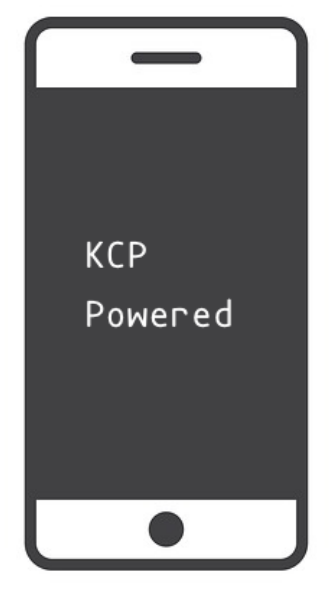

# libkcp

[](https://github.com/skywind3000/kcp)
[](https://img.shields.io/github/created-at/xtaci/kcp-go)

A frame-driven, single-connection KCP client library with Reed-Solomon FEC,
compatible with [kcp-go](https://github.com/xtaci/kcp-go). Each session owns
one connected UDP socket; this library does not implement a listener or
connection multiplexing.



## Features

- C99 session, FEC, Reed-Solomon and optional encryption APIs.
- Nonblocking, frame-driven reads, writes and updates.
- Optional packet encryption compatible with kcp-go, with or without FEC.
- Automatic detection of the peer's FEC shard configuration on receive.
- IPv4 and IPv6 numeric addresses on Windows and POSIX systems.

The former C++ APIs have been replaced by C APIs; existing applications must
migrate to `kcp_session_*`, `fec_*` and `rs_*`.

## Project layout

- `include/`: C headers, including the internal crypto backend interface
- `src/`: C library implementation
- `tests/`: unit tests and the kcp-go interoperability matrix
- `examples/`: sample echo server

## Build and test

The default build has no encryption dependency and requires only a C compiler:

```sh
cmake -S . -B build
cmake --build build --parallel 2
ctest --test-dir build --output-on-failure
```

Pass `-DBUILD_TESTING=OFF` to build only the library.

For encryption, install LibTomCrypt with its development headers and enable
the optional backend:

```sh
cmake -S . -B build-crypto -DKCP_ENABLE_CRYPTO=ON
cmake --build build-crypto --parallel 2
ctest --test-dir build-crypto --output-on-failure
```

Set `CMAKE_PREFIX_PATH` if CMake cannot locate LibTomCrypt. The library uses C
throughout; no C++ compiler or runtime is needed. Windows builds require
Winsock and BCrypt; CMake links them automatically. For iOS or Android,
provide a LibTomCrypt build for the target architecture and toolchain. Link
the `kcp` CMake target to inherit its dependencies.

## Session usage

```c
#include "sess.h"

int run_session(const uint8_t *key, size_t key_length) {
    kcp_crypt *crypt = kcp_crypt_create(KCP_CRYPT_AES_GCM, key, key_length);
    if (!crypt) return -1;
    kcp_session *s = kcp_session_dial("127.0.0.1", 9999, 2, 2, crypt);
    if (!s) {
        kcp_crypt_destroy(crypt);
        return -1;
    }
    kcp_session_nodelay(s, 1, 20, 2, 1);
    kcp_session_wndsize(s, 128, 128);
    kcp_session_set_stream(s, 1);

    /* Each frame: write pending data, call kcp_session_update(s, time_ms),
       then read available data. Check each return value. */

    kcp_session_destroy(s);
    kcp_crypt_destroy(crypt);
    return 0;
}
```

`key` and `key_length` must come from the application; do not hard-code
production keys. The session borrows `crypt`, which must outlive it and must
not be used concurrently by multiple sessions. Pass `NULL` to disable packet
encryption. FEC sending is disabled if either shard count is zero. Positive
data and parity counts may total at most 256. The receiver accepts raw KCP
packets and automatically detects a peer's FEC configuration, even when local
FEC sending is disabled. Detection requires complete data and parity pulses;
FEC recovery is not guaranteed until enough packets arrive to identify them.
Receiving a new configuration does not change the local sending configuration.
`kcp_session_update` reports operational errors
with `-1` and `errno`; invalid or unauthenticated incoming packets are dropped.
Reads return zero when no data is ready. `kcp_session_set_mtu` sets the KCP
MTU, excluding the FEC and encryption overhead; encrypted UDP packets are
limited to 1472 bytes.

See `include/sess.h`, `include/fec.h`, `include/reedsolomon.h` and
`include/crypt.h` for ownership and return values.
`tests/kcp_test.c` demonstrates the frame loop.

## Encryption

The optional backend implements these kcp-go formats:

| Algorithm | Key length in bytes |
| --- | --- |
| AES-GCM, AES, Twofish | 16, 24 or 32 |
| CAST5, TEA, XTEA | 16 |
| Triple-DES | 24 |
| Blowfish | 1–56 |
| Salsa20 | Any; padded or truncated to 32 |
| SimpleXOR | Any |
| None | Ignored |

SM4 is not supported by the current LibTomCrypt backend; requesting
`KCP_CRYPT_SM4` fails with `ENOTSUP`. The key bytes must match the corresponding
kcp-go constructor. Salsa20 follows
kcp-go's zero-padding/truncation to 32 bytes. `KCP_CRYPT_NONE` is not the same
as passing `NULL`: it still uses kcp-go's legacy nonce and CRC framing.
Applications can also supply custom AEAD callbacks with
`kcp_crypt_create_aead`, matching kcp-go's `NewAEADCrypt` framing.

AES-GCM provides authenticated encryption and is recommended. Legacy modes
use CRC32, which **does not authenticate packets**; SimpleXOR and None do not
provide meaningful confidentiality. These formats do not provide replay
protection or key exchange; supply and protect keys separately.

## kcp-go interoperability tests

With the encrypted build and a local checkout of kcp-go:

```sh
cd /path/to/kcp-go
go run /path/to/libkcp/tests/interop.go /path/to/libkcp/build-crypto/tests/kcp_test
```

The matrix tests both directions with 64 KiB payloads, plaintext, every
built-in supported cipher and key-size variant listed in the test, and a deliberately
insecure test-only custom AEAD. FEC configurations are disabled, 1+1, 2+2,
2+3, 3+2, 5+3 and 10+3. Each enabled configuration is tested without loss
and with `min(data, parity)` data shards dropped from one group in each
direction; all retransmissions of the selected KCP segments are also dropped.
The echo must match byte-for-byte, so successful loss cases require FEC
recovery. CI runs the same matrix on Linux, macOS and Windows.

The matrix additionally exercises asymmetric shard settings and one-sided FEC
with plaintext, AES-GCM, legacy AES and a test-only AEAD. Loss cases drop shards
after the receiver has had time to detect the configuration, and block their
KCP retransmissions to verify actual FEC recovery.

To run the unencrypted 2+2 FEC echo demo instead, start
`go run /path/to/libkcp/examples/kcpserver.go` from the kcp-go module directory
and run `build/tests/kcp_test`.
